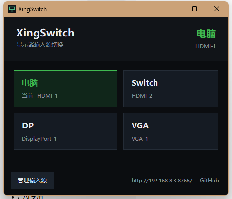
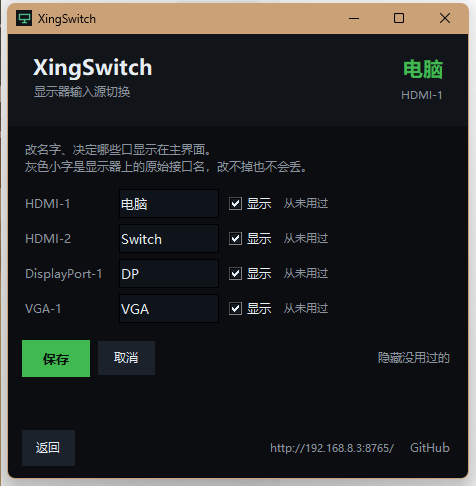
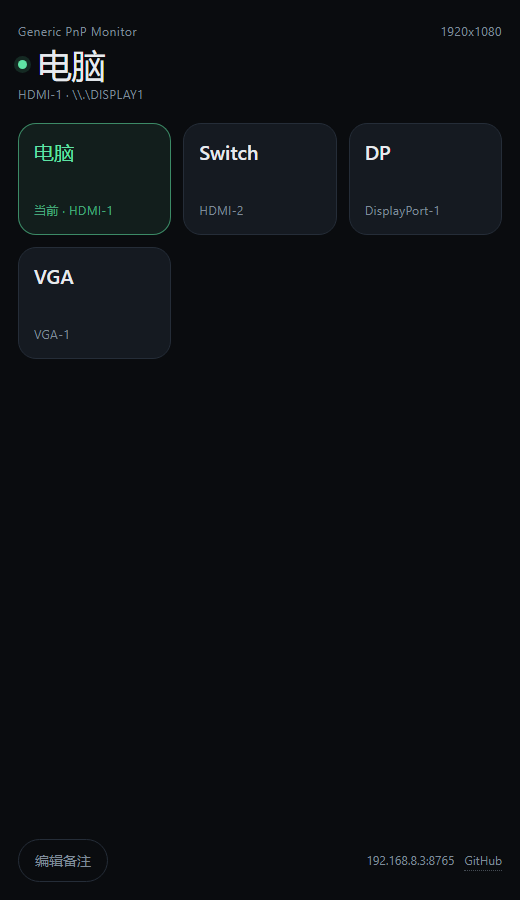

# XingSwitch

一个常驻 Windows 托盘的显示器输入源切换器 —— **托盘右键直接切，左键开窗口，手机也能切。**

A tiny DDC/CI input-source switcher for Windows. Right-click the tray to switch, left-click for the window, or use your phone over LAN.

<p align="center">
  
</p>

## 为什么要做这个

一台显示器接了电脑和游戏机。切到游戏机之后，电脑就没画面了 —— 想切回来得伸手按显示器上的按钮。

XingSwitch 就干一件事：**让"切回来"这件事不用起身。**

- 托盘右键 → 直接选输入源，不弹窗口
- 托盘左键 → 打开控制窗口
- 手机连同一个 WiFi，浏览器打开 `http://电脑IP:8765/`，躺着也能切

不用 KVM，不用树莓派，不用装 App。

## 功能

- **输入源自定义备注**：`HDMI-1` 改成「电脑」、`HDMI-2` 改成「Switch」。原始接口名始终以小字保留，换设备时不会认错。
- **按使用记录隐藏**：管理页显示每个口「今天用过 / 3 天前用过 / 从未用过」，一键隐藏没用过的。
- **手机端**：同一个页面，可添加到主屏幕当 App 用。也支持 `http://IP:8765/go?v=0x12` 这种直达链接，绑到手机桌面快捷方式上，点一下直接切。
- **切完回读校验**：命令发出去不等于生效，必须读回来确认才报成功。
- **防 DDC 卡死**：内置切换冷却、失败熔断（详见下文）。
- 零第三方依赖：只用 Python 标准库 + `ctypes`。

<p align="center">
  
  
</p>

## 下载

去 [Releases](../../releases) 下 `XingSwitch-x.x.x-Setup.exe`，双击安装即可，**不需要装 Python**。

从源码跑：装好 Python 3.8+（需含 tkinter），双击 `启动 XingSwitch.bat`。

## 用法

| 操作 | 结果 |
|---|---|
| 托盘右键 | 输入源菜单，当前项带勾，点一下即切 |
| 托盘左键 | 打开控制窗口 |
| 关窗口 | 收回托盘，程序继续运行 |
| 退出 | 托盘右键 → 退出 |

装完会在开始菜单、桌面留快捷方式，并加入开机自启。卸载走「设置 → 应用」或开始菜单里的卸载项。

配置文件在同目录 `config.json`，可改端口、备注、默认显示器、开源地址。

## 原理

Windows 的 `dxva2.dll` 可以直接对显示器发 DDC/CI 命令，VCP 码 `0x60` 就是「输入源」，写进一个值显示器就换口。

三个关键实现细节，都是踩坑之后才这么写的：

1. **每次操作前重新枚举显示器**，绝不复用句柄 —— 输入源一变，旧句柄就作废。
2. **切完回读校验**，否则界面会显示一个假的「成功」。
3. **限速**：两次切换强制间隔 3 秒，切换后先等 1.2 秒再校验，连续失败 3 次熔断 30 秒。

## ⚠️ 已知限制

### DDC 卡死

部分显示器的 DDC 固件很脆（本机 AOC 24G2）：**短时间内连续切两次，或切到一路没有信号的输入，可能把 DDC 状态机卡死**。

卡死现象：画面完全正常、显示器 OSD 和按键也都正常，但电脑这边再也读不到、写不进任何 DDC 命令。软件救不回来（试过盲写输入源、盲写电源码、切分辨率重训链路，全部无效）。

**复位方法：把 HDMI 线拔下来等 3 秒再插回**，或给显示器断电 10 秒。然后点界面上的「重新检测」。

程序已内置冷却与熔断来降低触发概率，但**这是显示器固件问题，无法 100% 避免**。

### 其它

- USB 转 HDMI 转接器、部分扩展坞不提供 DDC/CI。
- 网页没有密码，任何能连上你局域网的人都能切。仅建议在家庭网络使用。
- 显示器切走后若彻底断开 DDC 通道（部分型号如此），就切不回来了，只能靠第三台常开设备挂在空口上当"遥控器"。

## 自己打包

```bat
py -3 -m pip install pyinstaller
build.bat
```

产物在 `dist\`：`XingSwitch.exe`（主程序）和 `XingSwitch-Setup.exe`（安装包）。

> 注意：`tkinter` 必须以正常 `import` 语句引入，PyInstaller 静态分析才能扫到；
> 用 `__import__()` 会导致漏打模块、打包后启动即崩。

## 目录

| 文件 | 作用 |
|---|---|
| `xingswitch.py` | 主程序：DDC + 托盘 + 桌面窗口 + HTTP 服务 |
| `ui.html` | 手机页面 |
| `installer.py` | 安装器 / 卸载器 |
| `tools/ddc_probe.py` | 独立探针，用来验证某台显示器支不支持跨输入源切换 |
| `build.bat` | 一键打包 |

## License

MIT
